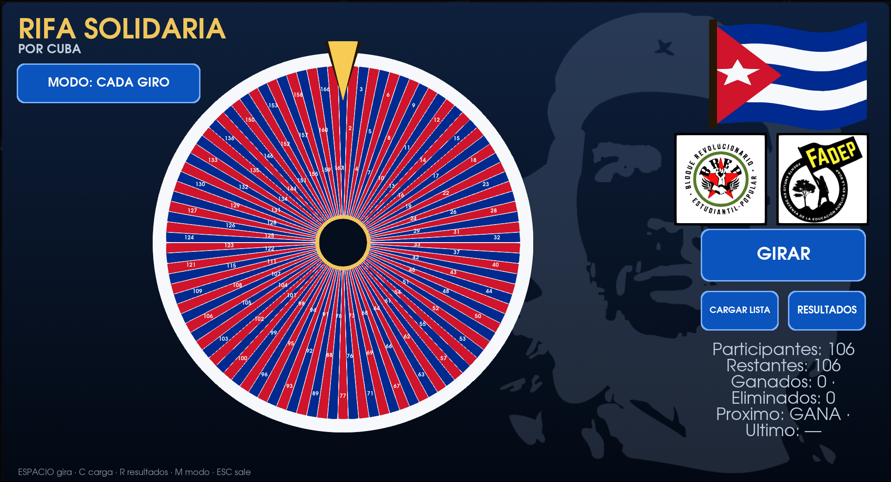
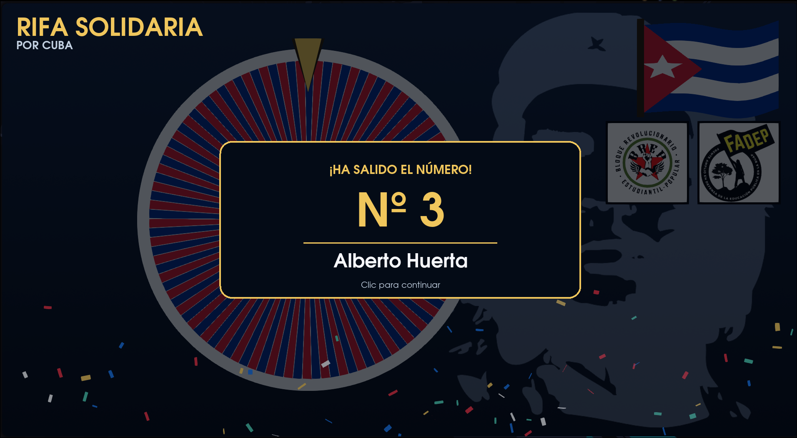

# Rifa Solidaria por Cuba

Ruleta de sorteo hecha con **Python + VTK**. Carga una lista de participantes
desde **Excel o CSV**, gira con animación y, al detenerse, oscurece el fondo y
muestra con una animación el **nombre y el número de la persona ganadora**.
La pantalla se queda así hasta que haces clic.



Al detenerse la ruleta, el fondo se oscurece y aparece el nombre del ganador:



---

## Puesta en marcha

```bash
./run.sh                                  # carga la lista privada si existe; si no, el ejemplo
./run.sh ruta/a/mi_lista.xlsx             # o carga directamente tu archivo
```

`run.sh` crea el entorno virtual `.venv`, instala VTK y `openpyxl` la primera
vez (la descarga de VTK son unos 200 MB) y arranca la aplicación. A partir de
ahí, los siguientes arranques son instantáneos.

Sin argumentos se busca automáticamente `rifa-solidaria-por-cuba.csv` en la
raíz del proyecto y, si no existe, `ejemplos/participantes.csv`. La lista real
está excluida de git porque contiene datos personales.

También se puede lanzar a mano:

```bash
python3 -m venv .venv
.venv/bin/pip install -r requirements.txt
.venv/bin/python main.py ejemplos/participantes.csv
```

### Comprobar un archivo sin abrir la ventana

```bash
.venv/bin/python main.py --validar mi_lista.xlsx
```

Imprime un resumen y los primeros participantes, y avisa de los problemas
(números repetidos, columnas no reconocidas, formato no soportado...).

---

## Formato del archivo

Cualquier `.csv`, `.xlsx` o `.xlsm` con **dos columnas: número y nombre**.

| numero | nombre                 |
|-------:|------------------------|
| 1      | Ana Lucía Fernández    |
| 2      | José Ramón Muñiz       |
| 3      | Dayana Rodríguez       |

Detalles que se detectan automáticamente:

* **Con o sin fila de cabecera.** Si la hay, se reconoce el nombre de las
  columnas (`numero`, `número`, `nº`, `id`, `bolo`, `#`… y `nombre`, `name`,
  `participante`, `persona`, `apellido`…).
* **Orden de las columnas.** Si no hay cabecera, se mira el contenido: da
  igual que el número vaya primero o segundo.
* **Separador del CSV**: coma, punto y coma, tabulador o barra vertical.
* **Acentos y ñ**: se usa una fuente del sistema con soporte Unicode.
* **Números con ruido** (`Nº 12`, `12.0`) se interpretan correctamente.
* **Una sola columna de nombres**: se numeran por orden de fila (1, 2, 3…).
* Las filas vacías se ignoran, los números se ordenan de menor a mayor y los
  **duplicados dan un error claro** en pantalla en vez de sortear mal.

Las filas cuyo número no tiene nombre se consideran **boletos no vendidos** y
se excluyen de la ruleta: un boleto no vendido nunca puede ganar. Por eso la
ruleta puede mostrar huecos en la numeración. `--validar` informa de los huecos
que existen dentro del rango de números cargado.

---

## Uso

| Acción | Cómo |
|---|---|
| Cargar un archivo | Botón azul **CARGAR LISTA** (o tecla `C`) |
| Girar | Botón azul **GIRAR** (o `Espacio`) |
| Ver los ganadores | Botón azul **RESULTADOS** (o `R`): se abre directo, sin preguntar archivo |
| Guardar `ganadores.csv` | Botón **GUARDAR CSV** dentro de la pantalla (o tecla `S`) |
| Cargar otro archivo de resultados | Tecla `L` dentro de la pantalla de ganadores |
| Cerrar la ventana del ganador | Un clic en cualquier parte (o `Espacio`) |
| Salir | `Esc` |

Los diálogos para **elegir** y para **guardar** archivos son los **del propio
escritorio** (XDG Desktop Portal): en KDE es el mismo cuadro de diálogo del
gestor de archivos (Dolphin), no una ventana aparte de la aplicación. Si el
portal no está disponible se usa `zenity` y, como último recurso, `tkinter`.
El de guardar es un diálogo de guardado de verdad (con su aviso de
sobrescritura), no el de carga.

Al girar, la ruleta da 6–9 vueltas y frena despacio. El ganador se decide
**antes** de girar y el ángulo final se calcula a partir de él, así que lo que
se ve bajo la aguja siempre coincide con el nombre que aparece después.

Los números que ya han salido **se eliminan del sorteo**: la ruleta se
reconstruye con los que quedan y cada persona puede ganar una sola vez. Cuando
se agotan, el botón GIRAR se deshabilita y el panel indica "Sorteo finalizado".

### Modo de sorteo

El botón **MODO** (o la tecla `M`) permite escribir cada cuántos giros gana uno:

* `1`: gana cada número que sale.
* `2`: sale un número que no gana y el siguiente gana.
* `3`: salen dos números que no ganan y el tercero gana.

El patrón se reinicia al cambiar el valor. La tarjeta de un número que salió
pero no gana se muestra en gris, sin confeti, y el número se elimina para que
no vuelva a salir. La pantalla indica si el próximo giro gana y cuántos
números fueron eliminados sin ganar.

La elección usa el generador pseudoaleatorio de Python. Un ordenador digital es
determinista y trabaja con representación binaria, por lo que no produce azar
físico verdadero: produce una secuencia pseudoaleatoria de muy buena calidad
para este uso. La opción `--semilla` permite repetir exactamente una secuencia
durante pruebas; en un sorteo normal no se fija ninguna semilla.

### Registro de giros y ganadores

Cada giro se añade al archivo `<tu_lista>_resultados.csv`, en la misma
carpeta que el archivo de entrada:

```csv
sesion,orden,numero,nombre,fecha_hora,resultado
2026-10-13 22:00:33,1,6,Ernesto Valdés,2026-10-13 22:00:35,gana
2026-10-13 22:00:33,2,11,Yordanka Hernández,2026-10-13 22:00:38,no_gana
```

El registro **nunca se borra**: se acumula, la columna `sesion` separa unas
ejecuciones de otras y los registros antiguos sin `resultado` se completan
automáticamente como `gana`. También se imprime en la terminal.

El archivo `<tu_lista>_ganadores.csv` contiene únicamente los ganadores de la
sesión actual, con el mismo formato `Número,Nombre` de una lista de entrada, y
se reescribe **solo, tras cada giro ganador**. Las filas van en **forma de
pila**: lo más reciente arriba, igual que en pantalla (y sirve igualmente como
lista de entrada para una segunda etapa o para continuar el sorteo). Tanto este
archivo como el registro de resultados se excluyen de git.

### Continuar una sesión interrumpida

Como `ganadores.csv` se va escribiendo solo, si la aplicación se cierra de
golpe **no se pierde nada**: al volver a cargar esa misma lista (al arrancar o
con **CARGAR LISTA**) se pregunta:

* **Sí** → se restaura la sesión: los ganadores desaparecen de la ruleta, los
  números que salieron sin ganar siguen eliminados, se recupera la sesión, el
  contador de giros y el modo "cada cuántos gana uno" (deducido del registro;
  si no se puede deducir se pregunta). En pantalla aparece
  *«Sesión restaurada: N ganadores · M eliminados»*.
* **No** → se empieza desde cero y el archivo de ganadores se vacía (el
  registro `_resultados.csv` **nunca se borra**: las sesiones antiguas siguen
  disponibles con `A`/`D` en la pantalla de resultados).

Si no hay ningún diálogo disponible para preguntar, no se destruye nada: el
archivo previo se copia a `<tu_lista>_ganadores_anterior.csv` y el sorteo
empieza desde cero.

La lista por defecto (`rifa-solidaria-por-cuba.csv` y, si no existe,
`ejemplos/participantes.csv`) **sigue cargándose automáticamente** como hasta
ahora; cargar archivos a mano sigue siendo una opción general con **CARGAR
LISTA**.

### Panel de resultados (proyectar/retransmitir)

El botón **RESULTADOS** (o `R`) muestra en pantalla la **lista de ganadores**
en grande, pensada para proyectar o retransmitir, **sin pedir ningún archivo**:

* Por defecto sale la **sesión actual** (la de esta ejecución); con `A`/`D`
  (o `←`/`→`) se cambia a otras sesiones del registro.
* Los ganadores se listan **en forma de pila: el más reciente arriba** (los
  premios se rifa de peor a mejor, así que arriba está el último entregado).
* Si hay muchos ganadores se reparte en páginas: un clic (o `Espacio`) pasa a
  la siguiente y, en la última, cierra el panel.
* **`S`** o el botón **GUARDAR CSV** abren el diálogo de guardado del sistema
  con `ganadores.csv` ya propuesto: guardan **la sesión que se está viendo**,
  en el mismo orden de la pila. (El archivo ya se va escribiendo solo tras
  cada giro; este botón solo lo confirma para llevárselo o subirlo.)
* `L` carga a mano otro archivo de resultados, `O` abre la carpeta en el gestor
  de archivos del sistema (Dolphin) y `Esc` cierra el panel.

---

## Ajustes

Todo lo visual está en `rifa/config.py`: la paleta de la ruleta (`PALETA`, con
el azul y el rojo de la bandera de Cuba), la duración del giro, el número de
vueltas, tamaños de fuente, el confeti y cuánto se oscurece el fondo. Por
ejemplo, para un giro más largo y tranquilo:

```python
DURACION_GIRO = 9.0
VUELTAS_MIN = 8
VUELTAS_MAX = 12
```

Y para desactivar el confeti:

```python
CONFETI = False
```

Los tamaños de letra están en las constantes `FUENTE_*` (título, botones, HUD
y panel de resultados). Se pueden subir sin miedo: el texto de los botones se
encoge solo si no cabe en su recuadro.

### Adornos

La ventana incluye una bandera cubana, una gran silueta del Che de fondo y los
logos grandes y visibles de las organizaciones indicadas en `LOGOS` (por
defecto **BREP** y **FADEP**, en la carpeta `doc/`). Todo vive en
`rifa/adornos.py` y se coloca solo, adaptándose al tamaño de la ventana.

La silueta del Che se toma de `RUTA_CHE` (por defecto `doc/che.svg`). El dibujo
oscuro se recorta y se tiñe con `COLOR_CHE`, y el fondo claro se vuelve
transparente de forma automática, así que sirve cualquier PNG/JPG sobre blanco;
`OPACIDAD_CHE` controla cuánto se ve.

```python
MOSTRAR_ADORNOS = True          # False esconde bandera, Che y logos
RUTA_CHE = "doc/che.svg"
COLOR_CHE = (0.72, 0.80, 0.94)  # tinte de la silueta
OPACIDAD_CHE = 0.16             # 1.0 = opaca
LOGOS = [
    ("BREP", "doc/breplogo.jpeg"),
    ("FADEP", "doc/FadepLOGO.jpg"),
]
LOGO_TAMANO_MAX = 190
LOGO_ALTO_REL = 0.22
```

Para añadir otra organización basta con agregar una tupla `(etiqueta, ruta)` a
`LOGOS`; el reparto coloca los logos en fila automáticamente.

---

## Estructura

```
rifa/
├── config.py      colores, tiempos, fuentes y tamanos (todo lo ajustable)
├── geometria.py   matematica pura de la ruleta (sin VTK, con tests)
├── datos.py       lectura de CSV/Excel, registro y continuation de ganadores
├── widgets.py     botones y textos 2D en pixeles de pantalla
├── ruleta.py      disco, aro, aguja y numeros
├── adornos.py     bandera de Cuba, silueta del Che y logos
├── reveal.py      sombreado, tarjeta del ganador, confeti y panel de resultados
├── archivos.py    diálogos de carga/guardado del sistema y gestor de archivos
├── _portal_chooser.py  selector nativo (XDG Desktop Portal, subproceso)
├── app.py         ventana, estados, eventos y animaciones
└── main.py        linea de comandos
```

---

## Desarrollo

```bash
.venv/bin/python tests/test_core.py               # tests de geometria y datos (sin VTK)
.venv/bin/python tools/capturas.py                # genera PNGs de cada fase en /tmp/opencode/capturas
.venv/bin/python -m rifa --validar lista.csv
```

`tools/capturas.py` es la herramienta para revisar el aspecto sin interactuar:
recorre un giro completo y guarda fotogramas de la carga, el giro, el reveal,
el estado posterior y la **pantalla de resultados en forma de pila**, además de
verificar que el ángulo final coincide con el ganador, que un segundo giro
sigue siendo coherente y que la lista del panel sale invertida. Trabaja sobre
una copia temporal de la lista, así que no deja archivos de resultados ni
activa la pregunta de continuación.

### Notas técnicas (VTK 9.7)

Cosas que costaron encontrar y conviene no volver a pisar:

* `vtkRenderer.AddActor2D` **ya no existe**: se usa `AddViewProp`.
* `vtkPolyDataMapper2D` **no escala** la geometría con `SetPosition2`; los
  rectángulos (botones, tarjeta, separadores) se construyen directamente en
  **coordenadas de pantalla** y se reconstruyen al redimensionar.
* `vtkTextActor.GetSize` necesita el viewport: `GetSize(renderer, [w, h])`.
* Los actores 2D se dibujan siempre por encima de la geometría 3D y se apilan
  en el orden en que se añaden. Por eso el sombreado del fondo es un quad
  **3D** translúcido: así oscurece la ruleta pero deja nítidos el nombre y la
  tarjeta, que son 2D.
* La aguja está fija en la parte superior y los sectores se centran en ella
  (`geometria.centro_sector`), de modo que nunca apunta a una frontera.
* `vtkTransform` aplica las operaciones por la derecha, así que para colocar el
  confeti hay que llamar a `Translate` **antes** de `RotateZ`/`RotateY`.
